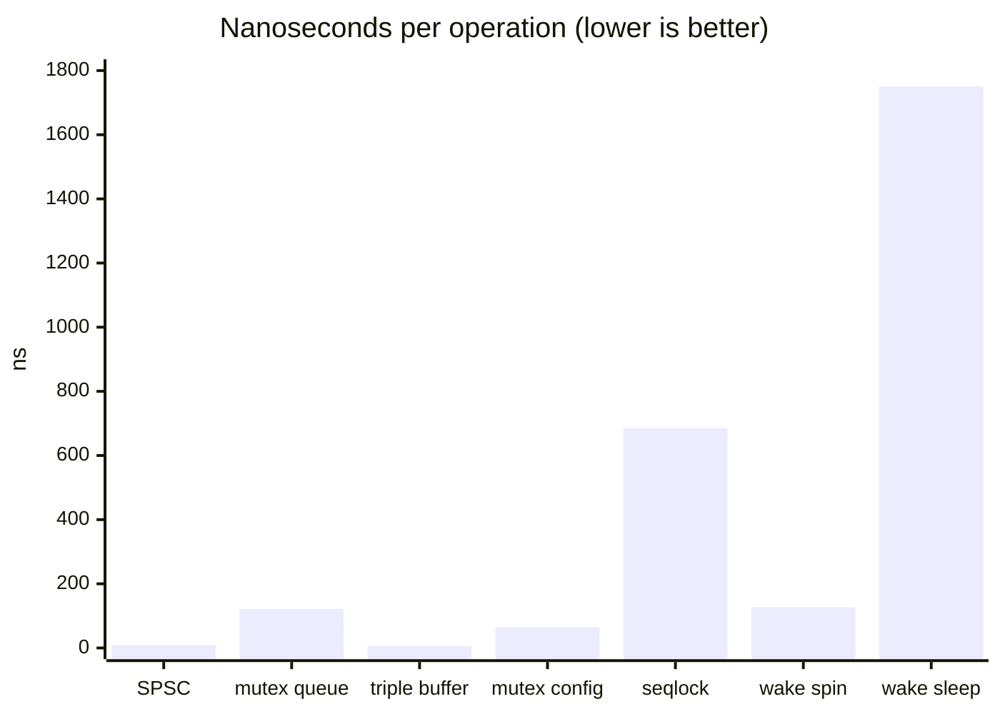

# Core benchmarks

Release build, MSVC 19.50. Machine reported by Google Benchmark: 4 x 2695 MHz, L1 data 32 KiB x4, L2 512 KiB x4, L3 4 MiB. Raw console log: [core_bench.txt](core_bench.txt). JSON: [results.json](results.json).

Times are the mean reported by Google Benchmark.

| Benchmark | Time | What it is |
|---|---|---|
| SPSC push/pop | 8.38 ns | One producer, one consumer, 32-bit slots |
| Mutex queue | 122 ns | Same traffic, `std::mutex` + `std::queue` |
| Seqlock load | 685 ns | Reader copies `Config` while a writer stores on every iteration |
| Mutex config load | 64.9 ns | Same hostile writer, under a mutex |
| Triple-buffer read | 5.48 ns | `try_read` against a writer that publishes every iteration |
| malloc 64 x256 | 17.9 us | 256 malloc/free pairs |
| Arena 64 x256 | 1.42 us | 256 bump allocations, one reset per iteration |
| Wake, 0 spin | 1751 ns | Round trip that sleeps immediately |
| Wake, 64 spin | 175 ns | Spin, then sleep if still idle |
| Wake, pure spin | 127 ns | Spin budget larger than the round trip |
| Ping-pong, same line | 11.3 ms / 100k | Two atomics with no padding |
| Ping-pong, 64 B | 14.6 ms / 100k | Each atomic on its own line |
| Ping-pong, 128 B | 15.1 ms / 100k | Padded past an adjacent-line prefetch |

## Preprocess (M2)

1280x720 BGRA letterboxed to 640x640 CHW float32, one frame per iteration.

| Variant | Time per frame | Throughput |
|---|---|---|
| Scalar | 1.76 ms | 1.95 GiB/s |
| AVX2 (gather + lane blend) | 1.02 ms | 3.36 GiB/s |

The AVX2 path is 1.7x faster. The rest of the frame budget at 50 fps is 20 ms, so neither path is a bottleneck on this 4-core machine. The win is real but bounded: both paths write the same 4.7 MiB of destination floats, which is cache miss traffic the SIMD cannot avoid. Full output: [preprocess.txt](preprocess.txt).

## How to read this

The SPSC ring is about 15 times faster than the mutex queue on this machine. That is the comparison the pipeline actually depends on.

The seqlock is slower than the mutex **in this benchmark** because the writer never pauses, so the reader retries. A config writer in the app stores a few times a second, not once per load. The seqlock is there so readers do not take a lock and do not write a shared cache line. It is the wrong tool if the writer is as busy as the reader. The triple-buffer number is a single atomic load plus, sometimes, a pointer swap. It does not copy `Config`. It is not the same work as the seqlock load.

The arena is about 12 times faster than malloc for 64-byte blocks, and it does not free until `reset`. That is the frame-scratch pattern. It is not a general allocator.

Sleeping in `WakeSeq` costs about 1.7 us on this box. A short spin (64 pauses) is close to a pure spin. The pipeline spins a little, then sleeps, so an idle capture thread does not sit on a core.

False sharing did **not** show the textbook result here. Separating the two atomics made the handoff slower, not faster. 100 000 round trips at 11–15 ms is about 110–150 ns each, which is the cache-to-cache cost on this CPU, and one line bouncing was cheaper than two. The padding is still in the ring, because other CPUs (and the adjacent-line prefetch the 128-byte column is there to show) do not behave like this one. The number is reported rather than adjusted.

Profile-guided optimisation, SIMD preprocess and the tracker sweep are later milestones. They are not in this table.

## Image GMC (M9)

One 1920x1080 BGRA frame reduced to a 160x90 grass-and-line image, then the coarse (5 scales x 15x15 shifts at 80x45) and fine (5 scales x 5x5 at 160x90) AVX2 SAD search. Runs on T3 every frame.

| Benchmark | Time per frame |
|---|---|
| `BM_ImageGmc` | 0.86 ms |

Under 5% of the 20 ms budget at 50 fps. If T3 p99 needs it, the reduce (strided reads from the 8 MiB frame) and the float bilinear zoom are the parts to look at first.

## Line refit (M9)

`BM_LineRefine`: three search-and-refit passes plus a scoring pass on a 1920x1080 frame showing a third of the pitch around one penalty area, starting 9 px off. About 300 marking samples, each a +-12 px ridge search along its image normal.

| Benchmark | Time per call |
|---|---|
| `BM_LineRefine` | 0.10 ms (0.15 ms wall while a replay shared the CPU) |

It runs on T3 every `line_interval` wide frames (default 2), and once per keypoint run to snap and score the keypoint fit.

## Mini replay (M15)

`BM_ThumbScale`: BGRA box filter to 480x270 (rows summed in 16-bit AVX2 lanes, columns as packed 64-bit adds). `BM_ClipCopy`: a 5.5 s window (138 thumbnails, ~71 MB) copied out of the ring.

| Benchmark | Time per call |
|---|---|
| `BM_ThumbScale` 1920x1080 | 1.2 ms |
| `BM_ThumbScale` 1280x720 | 0.63 ms |
| `BM_ClipCopy` | 12 ms |

The thumbnail first ran on T3 and doubled the track stage on the frames it stored (selftest, 1280x720, 20 s: p50 0.54 -> 1.0 ms, p99 1.1 -> 2.3 ms). It now runs on the present thread, after the latency stamp, which already holds the frame for upload. Telemetry, `--selftest --seconds 20`, three runs each, `--mini-replay 1` vs `0` (~500 thumbnails per run at 0.7-0.8 ms):

| Stage p99 (ms) | on | off |
|---|---|---|
| preprocess (T1) | 1.07 / 1.14 / 1.16 | 1.14 / 1.47 / 1.42 |
| inference (T2, stub) | 0.15 / 0.16 / 0.17 | 0.17 / 0.17 / 0.23 |
| track (T3) | 1.08 / 1.15 / 1.17 | 1.09 / 1.06 / 1.09 |

No added p99 on T1 to T3. Present latency in the selftest is set by its pacing and moves 10-50 ms between runs either way, so it is not compared. The clip copy runs on T7, which polls every 50 ms, so a clip is ready well inside 2 s of its window's end. Memory: ring 78 MB plus two clips of 73 MB, allocated in `Pipeline::start`.
